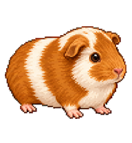
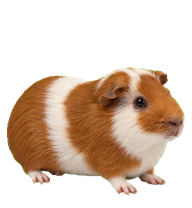
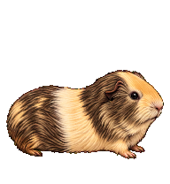
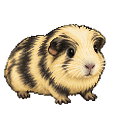
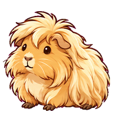

# 天竺鼠陪你工作 🐹

把五隻天竺鼠分享給大家。你可以直接領養牠們，讓牠們在 ChatGPT Work 裡陪你工作；也可以使用「照片天竺鼠・像素寵物」skill，依自己的照片製作新夥伴。

## 先選一隻喜歡的

點選「領養」開啟 ChatGPT 分享頁，依頁面提示加入自己的寵物收藏。需要可使用寵物功能的 ChatGPT 帳號與環境。

| 酸奶（像素版） | 酸奶 | 花蛤蜊（小花） | 烤肉 | 椒麻雞 |
| :---: | :---: | :---: | :---: | :---: |
|  |  |  |  |  |
| [領養](https://chatgpt.com/s/sharepet_6ae872612c1881918cc00206cd6bd451) | [領養](https://chatgpt.com/s/sharepet_6ae87264d67081919530e4949cf07ebd) | [領養](https://chatgpt.com/s/sharepet_6ae8726a1af08191a2b4aa9ca2cef1fd) | [領養](https://chatgpt.com/s/sharepet_6ae87270d2948191923c174cbcbf60df) | [領養](https://chatgpt.com/s/sharepet_6ae87277405481918fdcceab8b717d3f) |

預覽顯示第一格靜態造型；領養的寵物有完整動畫。這裡分享的是五隻數位夥伴，不含原始生活照片。

## 下載完整素材

- [五隻寵物完整素材包](guinea-pig-pets.zip)：每隻各有完整 `spritesheet.png` 與 `pet.json`。
- [照片天竺鼠・像素寵物技能包](photo-guinea-pig-pet.zip)：可供支援 skills 的環境匯入；內容為既有技能的匯出版本。
- [技能中文版說明](SKILL.zh-TW.md)：用途、依賴工具、安裝與使用範例。
- [檔案清單](manifest.json) 與 [SHA-256 校驗值](SHA256SUMS)：方便保留自己的備份。

| 寵物 | 格式 | 完整動畫圖尺寸 | 內容 |
| --- | --- | --- | --- |
| 酸奶（像素版） | v2 | 1536 × 2288 | 九種動畫、十六個注視方向 |
| 酸奶 | v2 | 1536 × 2288 | 九種動畫、十六個注視方向 |
| 花蛤蜊（小花） | v1 | 1536 × 1872 | 九種動畫 |
| 烤肉 | v2 | 1536 × 2288 | 九種動畫、十六個注視方向 |
| 椒麻雞 | v2 | 1536 × 2288 | 九種動畫、十六個注視方向 |

小花保留現有九列格式，沒有補造十六方向，也沒有誤標成 v2。

## 我只想使用這五隻

直接點上方領養連結即可，不需要安裝製作技能。若分享連結日後失效，可下載素材 ZIP，解壓縮後將選定寵物資料夾中的完整 `spritesheet.png` 與 `pet.json` 提供給支援寵物匯入的 ChatGPT Work，請它保留原圖重新匯入，並先驗證格式。匯入會建立自己的新寵物記錄。

若使用支援本機自訂寵物格式的 Codex，可把單一 `pets/<名稱>/` 資料夾放入自己的 `~/.codex/pets/`，或自訂 Codex 資料目錄中的 `pets/`。資料夾內兩個檔案必須保留在一起；同名資料夾請先備份。此處沒有自動安裝或覆寫腳本。平台支援仍以當時版本為準，本次沒有另外建立測試寵物。

## 我想用自己的照片製作

下載並匯入 `photo-guinea-pig-pet.zip`，依 [中文版說明](SKILL.zh-TW.md) 使用 `$photo-guinea-pig-pet`。這個技能會先確認花色、比例與細緻像素造型，再逐步製作九種動畫、十六方向，檢查眼睛、四肢和花色是否跑掉。

它是製作 ChatGPT 動態寵物的工作流程，不是 LINE 貼圖上架工具，也不是會自行運作的程式。製作時仍需要官方 `work-pets:create-pet` 流程、圖片生成工具及 Pets 功能；這些依賴未打包重發，沒有相關工具的環境不能只靠此 ZIP 完成寵物安裝。

## 分享與使用

歡迎下載、領養並在自己的 ChatGPT 或 Codex 中使用這五隻寵物，也歡迎使用此技能製作自己的寵物。若轉貼素材或技能，請保留本專案連結與來源；若有修改，請標示修改內容。商業利用或將素材另外販售，請先取得同意。

## 公開前整理

分享日期：2026-11-02。

- 完整動畫圖與取得的原件逐位元組一致，沒有以預覽縮圖替代。PNG 結構、CRC、解壓縮大小與尺寸已檢查；只含 `IHDR`、`IDAT`、`IEND`，沒有 EXIF、GPS、文字或其他附加區塊。
- 寵物設定只含公開名稱、簡介、格式與相對圖片路徑；資料夾代號不是帳號內部寵物 ID。
- 技能採用既有的細緻像素版匯出內容，保留技能名稱、參考文件與圖示；未夾帶個人照片或製作紀錄。
- 公開內容不含原帳號內部 ID、私人信箱、實際電腦路徑、對話、提示詞紀錄、臨時下載網址、Cookie、API 金鑰或憑證。上方公開領養連結是供分享使用的連結。
- ZIP 只含列出的圖檔、設定與文件，沒有執行檔、符號連結、隱藏檔或舊 Git 歷史。技能中的工作流程文字與通用範例保留。
- 根目錄 `SHA256SUMS` 可核對下載檔；素材 ZIP 內另有校驗值。此檢查限於本次公開檔案。

任何人都可以下載這些已公開的名稱與圖像，也會看到分享此專案的 GitHub 帳號。請不要在 issue 裡張貼登入資料或未打算公開的私人照片。
